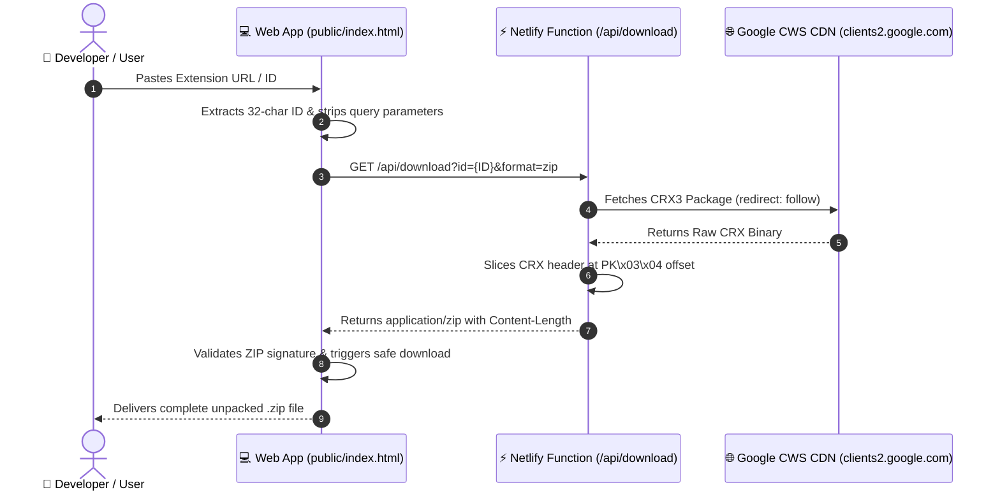

<div align="center">

  # ⚡ Chrome Extension CRX & ZIP Downloader
  
  **Download and unpack any Google Chrome extension directly as a clean `.ZIP` or original `.CRX` archive.**

  [](https://app.netlify.com/)
  [](https://nodejs.org/)
  [](https://developer.mozilla.org/)
  [](https://chromewebstore.google.com/)
  [](LICENSE)
  [](https://hiteshkhambhoo.com)

  <br>

  <p align="center">
    <a href="#-key-features">Key Features</a> •
    <a href="#-architecture--how-it-works">Architecture</a> •
    <a href="#-quick-start">Quick Start</a> •
    <a href="#-api-documentation">API Docs</a> •
    <a href="#-load-unpacked-guide">Chrome Setup</a> •
    <a href="#-author--developer">Author</a>
  </p>

</div>

---

## 🌟 Overview

**Chrome Extension CRX & ZIP Downloader** is a high-performance web tool and serverless utility engineered to fetch, unpack, and download Google Chrome extensions directly from the Chrome Web Store without installing them to your browser. 

It automatically strips Google's binary **CRX3/CRX2 Protocol Buffer headers** on the fly, outputting a standard, compliant `.zip` archive ready to be loaded via **Developer Mode (`chrome://extensions`)** across all Chromium-based browsers.

```
       [ Chrome Web Store URL / 32-Char ID ]
                        │
                        ▼
       [ Netlify Serverless Function (Node 18+) ]
                        │
     ┌──────────────────┴──────────────────┐
     ▼                                     ▼
[ Fetch CRX Binary from Google ]   [ Auto-Resolve Slug/Query ]
     │
     ▼
[ Strip Protobuf & Locate PK\x03\x04 Header ]
     │
     ▼
[ Stream Clean Standard .ZIP to Client ]
```

---

## ✨ Key Features

| Feature | Description |
| :--- | :--- |
| 📦 **Instant ZIP Unpacking** | Strips 12-byte CRX magic + Protocol Buffer metadata, giving you the unpacked source code instantly. |
| 🛡️ **Zero 0-Byte Downloads** | Patched against Chromium asynchronous stream revocation bugs with 60-second safe memory buffers. |
| 🔍 **Smart Auto-Resolver** | Automatically resolves extensions even if query parameters (`?hl=en`) or incomplete URLs are provided. |
| 🌐 **100% Serverless** | Built on Netlify Functions v2 with zero server maintenance, auto-scaling, and edge caching. |
| 🎨 **Modern Dark SaaS UI** | Glassmorphism interface with ambient animated glow, command bar input, and 1-click test chips. |
| 🚀 **Chromium Compatible** | Output archives work on Google Chrome, Brave, Microsoft Edge, Opera GX, Vivaldi, and Arc. |

---

## 🏗️ Architecture & Data Flow



---

## 🚀 Quick Start & Deployment

### 1. One-Click Deploy to Netlify

You can deploy this application directly to **Netlify** with zero configuration:

[](https://app.netlify.com/start)

1. Fork or push this repository to your GitHub account:
   ```bash
   git clone https://github.com/hitesh3119/Chrome-Extension-Downloader.git
   cd Chrome-Extension-Downloader
   ```
2. Log in to [Netlify](https://app.netlify.com/) and click **Add new site > Import an existing project**.
3. Select your repository. Netlify automatically detects:
   - **Publish directory:** `public`
   - **Functions directory:** `netlify/functions`
4. Click **Deploy**. Your app is live in seconds!

### 2. Run Locally in Development

```bash
# Clone the repository
git clone https://github.com/hitesh3119/Chrome-Extension-Downloader.git
cd Chrome-Extension-Downloader

# Start local Netlify development server
npx netlify dev
```
Open **`http://localhost:8888`** in your browser.

---

## 📖 API Documentation

The serverless function can also be consumed programmatically by CLI tools, curl, or external web services:

### Endpoint:
```http
GET /api/download
```

### Query Parameters:

| Parameter | Type | Required | Default | Description |
| :--- | :--- | :--- | :--- | :--- |
| `id` | `string` | Optional* | — | 32-character Chrome extension ID (e.g. `gldebcpkoojijledacjeboaehblhfbjg`). |
| `url` | `string` | Optional* | — | Full Chrome Web Store URL. |
| `format` | `string` | No | `zip` | Format to return: `zip` (unpacked) or `crx` (raw binary). |
| `name` | `string` | No | `{id}` | Custom filename for `Content-Disposition`. |

*\*Either `id` or `url` must be provided.*

### Examples:

#### Download as ZIP (curl):
```bash
curl -L -o extension.zip "https://your-site.netlify.app/api/download?id=lankjdlpcafockikacbnbdngppglhjim&format=zip"
```

#### Download Raw CRX:
```bash
curl -L -o extension.crx "https://your-site.netlify.app/api/download?id=lankjdlpcafockikacbnbdngppglhjim&format=crx"
```

---

## 🛠️ How to Load Unpacked Extensions in Chrome

Once your `.zip` file is downloaded:

1. **Extract Archive:** Right-click the downloaded `.zip` file and extract it into a folder.
2. **Open Extensions Page:** In Google Chrome, navigate to:
   ```text
   chrome://extensions/
   ```
3. **Enable Developer Mode:** Toggle **Developer mode** in the top-right corner.
4. **Load Unpacked:** Click **Load unpacked** in the top-left and select your extracted folder.
5. **Ready:** The extension will now run offline without Chrome Web Store tracking or account syncing!

---

## 📁 Repository Structure

```text
Chrome-Extension-Downloader/
├── public/
│   ├── index.html        # Modern Glassmorphism UI & SEO Architecture
│   ├── style.css         # Dark theme, glow animations & responsive grid
│   ├── app.js            # URL parsing, safe memory blob streaming & unpacker
│   ├── robots.txt        # Search engine crawler permissions
│   └── sitemap.xml       # Search engine indexation sitemap
├── netlify/
│   └── functions/
│       └── download.mjs  # Serverless CRX3 binary protocol buffer stripper
├── netlify.toml          # Netlify routing, security headers & build config
├── package.json          # Node ES Module manifest
├── push_to_github.bat    # 1-Click Windows Git Deployment Script
├── .gitignore            # Git exclusion rules
└── README.md             # Project documentation
```

---

## 👨‍💻 Author & Developer

<table align="center">
  <tr>
    <td align="center">
      <a href="https://hiteshkhambhoo.com">
        <br />
        <sub><b>Hitesh Khambhoo</b></sub>
      </a>
      <br />
      <sub>Lead Architect & Full-Stack Developer</sub>
      <br /><br />
      <a href="https://hiteshkhambhoo.com">🌐 Website</a> •
      <a href="https://github.com/hitesh3119">🐙 GitHub</a>
    </td>
  </tr>
</table>

- **Portfolio & Official Site:** [hiteshkhambhoo.com](https://hiteshkhambhoo.com)
- **GitHub Profile:** [@hitesh3119](https://github.com/hitesh3119)
- **Specialization:** High-performance web architecture, serverless microservices, and modern UI engineering.

---

## 📄 License

This project is licensed under the **MIT License** — see the [LICENSE](LICENSE) file for details. Free for open-source and commercial applications.
